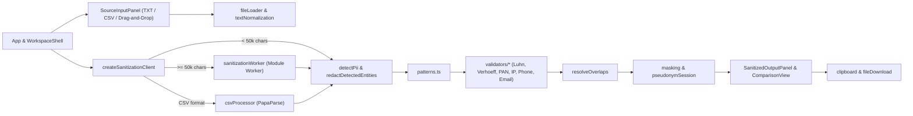

# CLEANROOM — Local PII Sanitization Utility

## 1. Overview & Platform Definition

**CLEANROOM** is a 100% client-side browser application for detecting, validating, and sanitizing personally identifiable information (PII) in plain text (`.txt` / pasted text) and structured `.csv` files.

- **What CLEANROOM is:** A zero-backend React + TypeScript browser utility where candidate scanning, checksum validation, redaction, CSV parsing, visual diffing, and file export execute entirely within volatile browser memory.
- **What CLEANROOM is not:** CLEANROOM is not a cloud API, desktop binary, custom browser, or identity-verification service.

## 2. Key Features

- **Six Validated PII Categories:** Emails, Indian and international phone numbers, IPv4/IPv6 addresses, Indian PAN tokens, Verhoeff-checked Aadhaar patterns, and Luhn-checked payment card numbers.
- **Three Redaction Modes:** Live switching across Full Masking (`[REDACTED]`), structural Partial Masking, and normalized session-scoped Consistent Pseudonymization (`[EMAIL_001]`, `[CARD_001]`, etc.).
- **Selective Category Toggles:** Toggle individual PII categories via `CategoryFilter` (with `Enable All` reset and zero-category safety guard) without resetting source text.
- **Local File & Drag-and-Drop Ingestion:** Supports `.txt` and `.csv` upload (`<= 5 MB`), drag-and-drop onto the editor, UTF-8 BOM stripping, binary null-byte rejection, auto-detach when clearing or replacing loaded CSV text via full-selection paste, and one-click `×` badge detachment to plain text.
- **One-Click Synthetic Fixtures:** Built-in `Load Sample` (noisy incident text) and `Sample CSV` (4-row quoted CSV with escaped quotes and repeated entities) including non-PII decoys (`2026-11-27`, `v2.4.1.0`, non-Luhn references).
- **Bounded Large-Input Performance:** Offloads inputs `>= 50,000` characters to a same-origin module Web Worker (`connect-src 'none'`, `worker-src 'self'`), with synchronous fallback and `100,000`-char / `200`-row DOM preview caps while keeping full output intact for `Copy` and `Download`.
- **PII-Free Local Activity Log:** Records operational metadata (timestamp, action, mode, format, count) reinforced by `sanitizeLogSummary`.

## 3. Architecture & Data Flow



## 4. Supported PII Categories & Redaction Modes

Detection candidates are validated **before** overlap resolution so malformed longer tokens cannot shadow valid overlapping entities.

| Category | Pattern Scope | Validation Method | Technical Check |
| --- | --- | --- | --- |
| Email Addresses | Local-part, `@`, domain labels, alphabetic TLD | `email-format` | Length bounds (local 1–64, domain 4–253), no consecutive/leading/trailing dots, valid domain labels and >=2-letter TLD |
| Phone Numbers | Indian (`+91`, `0`, 10-digit mobile) and international (`+`, `00`, formatted NANP) | `phone-structure` | Balanced parentheses, allowed separators, rejects date patterns and repeated digits, validates E.164/Indian/NANP structure |
| IP Addresses | IPv4 dotted quads and IPv6 (uncompressed and `::` compressed) | `ipv4-parse` / `ipv6-parse` | IPv4: 4 octets in `0–255` without leading zeros; IPv6: RFC 4291 8-group or single-`::` hex parsing |
| Indian PAN | 10-character uppercase alphanumeric token | `pan-format` | Exact `[A-Z]{5}[0-9]{4}[A-Z]` layout and official 4th-character entity holder code (`A, B, C, F, G, H, J, L, P, T`) |
| Indian Aadhaar Pattern | 12 digits starting `2–9` (contiguous or uniform space/hyphen `4-4-4`) | `verhoeff-checksum` | Non-identical digits, consistent separator check, and dihedral group D5 Verhoeff checksum |
| Credit Card Candidate | 13–19 digits (contiguous or space/hyphen grouped) | `luhn-checksum` | Non-identical digits, group structure check, and Luhn Mod-10 checksum |

> **Validation Disclaimer:** Format and checksum checks verify structural plausibility only and never confirm identity, UIDAI/tax issuance, or active payment card status.

### Redaction Modes
1. **Full Masking (`full`):** Replaces every detected entity with `[REDACTED]`.
2. **Partial Masking (`partial`):** Retains minimal non-sensitive context (e.g., `A***@example.org`, `XXXX-XXXX-XXXX-1111`, `ABXXXXXX4F`, `+XX XXXXX X3210`, `192.XXX.XXX.XXX`, `2001:XXXX::XXXX`).
3. **Consistent Pseudonymization (`pseudonymize`):** Assigns deterministic zero-padded placeholders (`[EMAIL_001]`, `[CARD_001]`) per normalized entity across a shared `PseudonymSession` and CSV cells.

## 5. Local Setup & Verification Scripts

```bash
npm install
npm run dev        # Start local Vite dev server
npm run typecheck  # Strict TypeScript check (app + Vite config)
npm run lint       # ESLint check across all TS/TSX files
npm run test:run   # Run Vitest unit, security, accessibility & integration suite
npm run build      # Typecheck + production build with injected CSP header
npm run preview    # Serve dist/ locally to verify production bundle & CSP
npm run verify     # Execute typecheck, lint, test:run, and build sequentially
```

## 6. Environment Variables

CLEANROOM requires **zero environment variables and zero API keys**. All runtime behavior executes locally in the browser without backend URLs or external credentials, enforced in production builds via `connect-src 'none'` in [`vite.config.ts`](vite.config.ts).

## 7. Core Engine & Utility API Reference

- `detectPii(text, options?)` (`src/engine/detectPii.ts`): Scans plain text across active categories, validates candidates before overlap resolution, and verifies exact source character offsets.
- `sanitizeText(text, options)` (`src/engine/redactPii.ts`): Runs `detectPii` + `redactDetectedEntities` with `mode`, optional `pseudonymSession`, and optional `enabledCategories`.
- `sanitizeCsvText(rawCsv, options)` (`src/utils/csvProcessor.ts`): Parses rectangular CSV via `papaparse` (`header: false`), preserves row 0 verbatim, sanitizes cells individually with one shared `PseudonymSession`, and returns `sanitizedCsv` plus paired `comparison` data.
- `createPseudonymSession()` (`src/engine/pseudonymSession.ts`): Encapsulates normalized in-memory placeholder maps (`getOrCreatePlaceholder`, `getEntryCount`, `clear`).
- `createSanitizationClient(options?)` (`src/utils/sanitizationClient.ts`): Routes small inputs synchronously and inputs `>= 50,000` characters to `sanitizationWorker.ts` with `requestId` correlation, `clearSession()`, and `dispose()`.
- `readLocalFile(file)` / `downloadSanitizedText(content, format, sourceFileName?)` (`src/utils/fileLoader.ts`, `src/utils/fileDownload.ts`): Local BOM-stripped file ingestion and sanitized filename Blob export with unconditional `URL.revokeObjectURL`.

## 8. Project Structure

```text
├── DESIGN_SYSTEM.md            # Immutable token & accessibility visual spec
├── DEMO_GUIDE.md               # Repeatable 3-5 minute demo script
├── SECURITY_AUDIT.md           # Static security & privacy audit record
├── SUBMISSION_REPORT.md        # Phase verification summary
├── eslint.config.js            # ESLint flat config (strict TS, hooks, no-console)
├── vite.config.ts              # Vite + Vitest config + production CSP injector
└── src/
    ├── engine/                 # Zero-UI PII detection, overlap resolution & redaction
    │   └── validators/         # Luhn, Verhoeff, PAN, phone, IPv4/IPv6, email checks
    ├── workers/                # Module Web Worker entrypoint (sanitizationWorker.ts)
    ├── utils/                  # File I/O, CSV processor, worker client, highlighting, log guard
    ├── types/                  # Strict TypeScript domain contracts
    ├── styles/                 # Immutable CSS tokens (tokens.css) & base styles
    ├── components/
    │   ├── layout/             # AppHeader
    │   ├── ui/                 # Badge, Button, CategoryFilter, ModeSelector, Panel
    │   └── workspace/          # WorkspaceShell, SourceInputPanel, SanitizedOutputPanel, ComparisonView, StatisticsPanel, ActivityLogPanel
    ├── security/               # Automated zero-network, zero-storage & XSS tests
    └── test/                   # Setup & end-to-end integration tests
```

## 9. Design Decisions & Threat-Model Scope

- **Validate Before Overlap Resolution:** Running checksum/structural validation prior to `resolveOverlaps` prevents invalid longer digit strings (e.g., an invalid 16-digit reference ID) from masking valid embedded entities.
- **No External Services or Persistent Storage:** Excluding cloud APIs, telemetry, `localStorage`, and external font CDNs allows offline operation under `connect-src 'none'`.
- **Single-Source Checksums & Bounded Previews:** `computeVerhoeffCheckDigit` in `aadhaarValidator.ts` drives both validation and synthetic fixtures, and preview truncation avoids browser DOM stalls while preserving complete data for export.
- **Threat-Model Limits:** Local execution removes server/network transmission risk during sanitization, but cannot protect against a compromised host OS, malicious browser extension, clipboard history manager, or screen-capture software.

## 10. Testing & Related Documentation

Verified via `npm run test:run` (**21 test files, 117 passing tests**).

- [DESIGN_SYSTEM.md](DESIGN_SYSTEM.md) — Immutable color tokens, typography scale, and accessibility/styling rules.
- [SECURITY_AUDIT.md](SECURITY_AUDIT.md) — Static security audit, production CSP policy, defense-in-depth controls, and threat-model limits.
- [DEMO_GUIDE.md](DEMO_GUIDE.md) — Repeatable 3-to-5-minute live demonstration walkthrough.
- [SUBMISSION_REPORT.md](SUBMISSION_REPORT.md) — Factual phase completion, verification matrix, and known boundaries.
